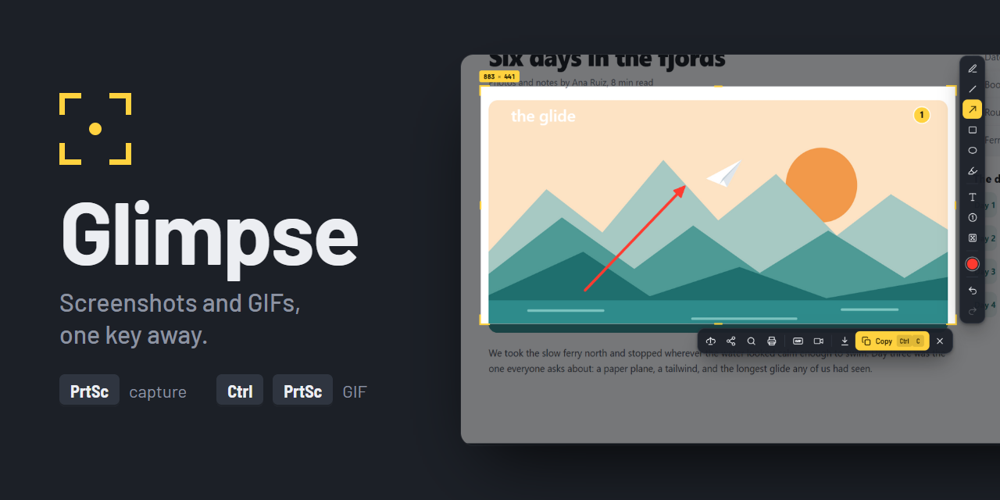
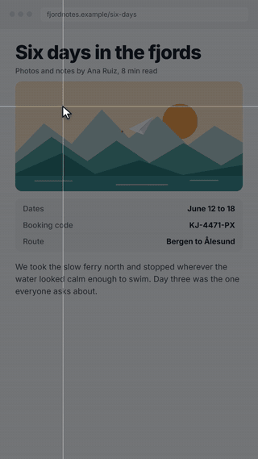
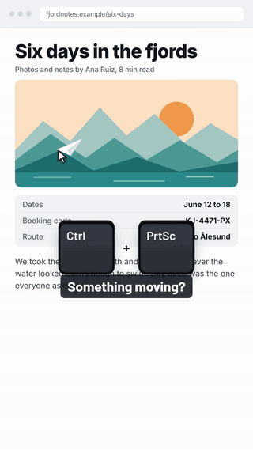

<p align="center">
  
</p>

<p align="center">
  <b><a href="https://github.com/04r/glimpse/releases/latest">Download for Windows</a></b>
</p>

<p align="center">
  
  &nbsp;&nbsp;
  
</p>

Press <kbd>PrtSc</kbd> and the screen freezes. Drag over what you need, mark it up, and copy, save or upload it. When it moves, <kbd>Ctrl</kbd> + <kbd>PrtSc</kbd> records it as a GIF or video instead.

- **Instant:** the screen freezes about 50 ms after the key, with no window animation.
- **Snap to windows:** hover a window and it lights up. Click without dragging to capture exactly that window.
- **Mark-up:** arrows, shapes, text, highlighter, numbered steps, and pixelate for anything private.
- **Grab text:** in the overlay, press <kbd>X</kbd> (or <kbd>Ctrl</kbd> <kbd>T</kbd>) and drag over any text: an image, a video, a game. It's copied right away and you stay in the overlay. It runs on Windows' built-in OCR and works offline.
- **Scrolling capture:** select part of a long page or chat, and Glimpse scrolls it and stitches one tall image. Sticky headers appear once. If an app ignores automatic scrolling, scroll it yourself and Glimpse stitches as you go.
- **Instant replay (clip it):** Glimpse keeps the last 10 seconds to 20 minutes of your screen in the background, and <kbd>Alt</kbd> <kbd>Z</kbd> saves them as a clip, like ShadowPlay. It records on your graphics card (NVENC, AMF or Quick Sync), so games barely notice. <kbd>Alt</kbd> <kbd>F9</kbd> starts a full recording.
- **Clip audio, your way:** everything you hear, only chosen apps (each with its own volume), or everything except one app such as Discord. Mic with push-to-talk, noise suppression and a noise gate. Clips get a mix track plus separate game and mic tracks.
- **Clip settings:** a whole screen or one app's window, resolution, 30 to 240 fps, quality presets or your own bitrate, H.264 or HEVC, and when to run (always, or only while your games are open).
- **Clips library:** clips are sorted by game. Watch them, trim them, export a file under 10 MB for Discord or a GIF, then copy or upload.
- **Make it pretty:** a full mockup editor. Browser, window, phone, tablet and laptop frames, 3D tilt (presets or free X/Y/Z rotation with perspective), shadows, gradient, mesh, solid or blurred backgrounds, grain, and sizes from 16:9 to 9:16. Export at 1× or 2×.
- **Share:** copy to clipboard, save as PNG/JPG, or upload for a link. Also share to social, find similar images with Google Lens, or print.
- **Every monitor at once:** all screens freeze together, and a selection can run across them. <kbd>Ctrl</kbd> <kbd>A</kbd> selects the screen under the cursor; press it again to select all of them.
- **GIF and video:** record any area, trim it on a filmstrip, and export GIF, MP4 or WebM.
- **Searchable history:** every capture's text is read in the background, so typing "invoice" in Captures finds the screenshot that showed one.

## Shortcuts

| | |
| --- | --- |
| <kbd>PrtSc</kbd> | Capture an area |
| <kbd>Ctrl</kbd> <kbd>PrtSc</kbd> | Record a GIF (press again to stop) |
| <kbd>Ctrl</kbd> <kbd>Shift</kbd> <kbd>PrtSc</kbd> | Record a video |
| <kbd>Ctrl</kbd> <kbd>Alt</kbd> <kbd>PrtSc</kbd> | Capture the whole screen |
| <kbd>Alt</kbd> <kbd>Z</kbd> | Save a clip (instant replay) |
| <kbd>Alt</kbd> <kbd>Shift</kbd> <kbd>Z</kbd> | Turn instant replay on or off |
| <kbd>Alt</kbd> <kbd>F9</kbd> | Start or stop a full recording |

You can change all of them in Settings (clip keys are in Clips). If the NVIDIA overlay is still installed it may own <kbd>Alt</kbd> <kbd>Z</kbd> and <kbd>Alt</kbd> <kbd>F9</kbd>: Glimpse tells you, and you can pick other keys or turn that overlay off. In the overlay, hover any button to see its key.

## Install

Download the installer (`Glimpse-Setup-<version>.exe`) from [Releases](https://github.com/04r/glimpse/releases/latest) and run it. Windows 10 and 11 are supported.

The installer isn't code-signed yet, so Windows SmartScreen may say it "protected your PC". Click **More info**, then **Run anyway**.

If <kbd>PrtSc</kbd> also opens the Snipping Tool, turn off *Settings → Accessibility → Keyboard → Use the Print screen key to open screen capture*.

<details>
<summary>Run from source</summary>

```bash
git clone https://github.com/04r/glimpse.git
cd glimpse
npm install
npm start
```

| Command | What it does |
| --- | --- |
| `npm run dist` | Builds the installer into `dist/` |
| `npm run selftest` | End-to-end test of capture, copy and GIF/MP4 export |
| `npm run speedtest` | Measures hotkey-to-frozen-screen time |
| `npm run featuretest` | Tests copy text, search, window snapping, scrolling capture and Make it pretty |
| `npm run clipstest` | Tests instant replay, recording, audio sync, the Clips library and export |
| `npm run build:audio` | Rebuilds the audio capture helper (`src/native/audio.cs`) with the .NET Framework compiler |
| `npm run multitest` | Tests the multi-monitor overlay on a simulated layout (set `GLIMPSE_FAKE_DISPLAYS`) |
| `npm run docs` | Regenerates the banner and screenshots from a neutral sample page |
| `npm run assets` | Regenerates the app icon and installer artwork |

Built with Electron, [node-screenshots](https://github.com/nashaofu/node-screenshots), [koffi](https://koffi.dev) and [ffmpeg](https://github.com/eugeneware/ffmpeg-static). Uploads are anonymous, go to [catbox.moe](https://catbox.moe), and only happen when you click Upload.
</details>

## License

MIT. The Barlow font is under the SIL Open Font License, and the icons are adapted from [Lucide](https://lucide.dev).
