<p align="center">
  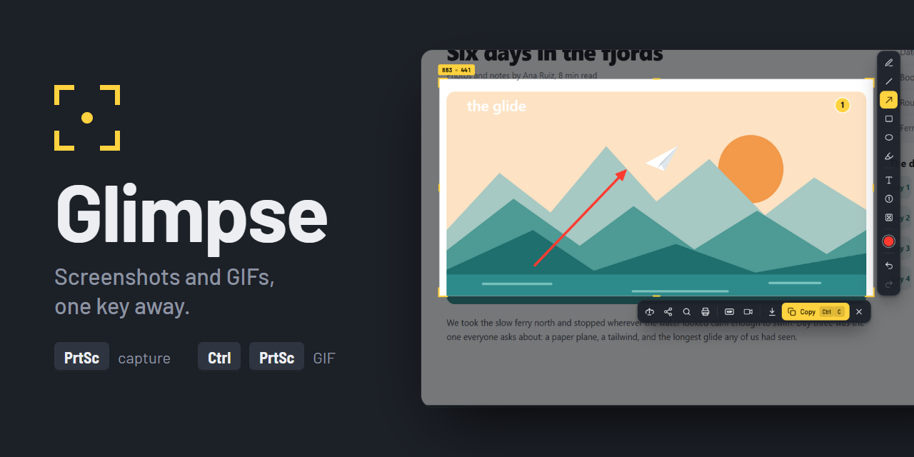
</p>

<p align="center">
  A fast, Lightshot-style capture tool for Windows. Press <kbd>PrtSc</kbd>, drag, mark it up, paste it anywhere.<br>
  And when it moves, press <kbd>Ctrl</kbd> + <kbd>PrtSc</kbd> and send a GIF instead.
</p>

<p align="center">
  <a href="#install">Install</a> ·
  <a href="#shortcuts">Shortcuts</a> ·
  <a href="docs/glimpse-showcase.mp4">Watch the 30 s showcase</a>
</p>

<table>
  <tr>
    <td align="center" width="50%">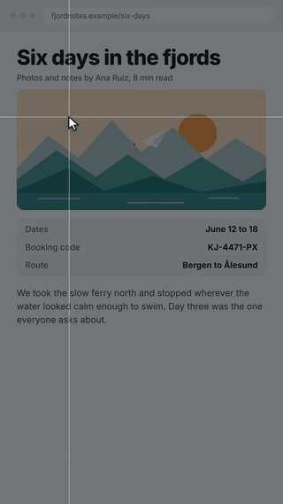<br><sub>Freeze, select, mark up, copy</sub></td>
    <td align="center" width="50%">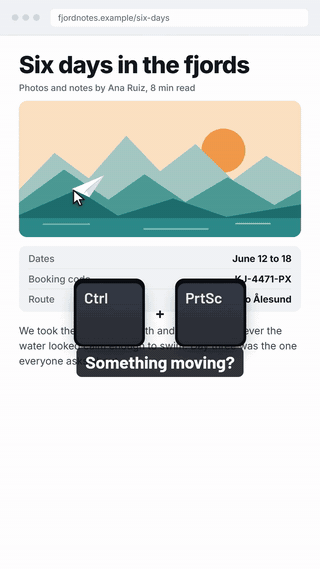<br><sub>Record a GIF, trim it, share a link</sub></td>
  </tr>
</table>

## Screenshots

The screen freezes the moment you press the key (about 50 ms), with no window animation in between. Drag over what you want and the tools appear next to your selection.

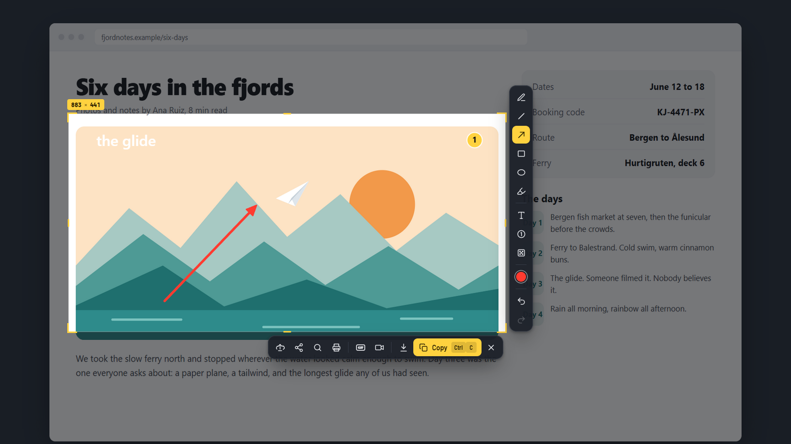

- **Mark it up:** pencil, line, arrow, rectangle, ellipse, highlighter, text, numbered steps and pixelate. Hold <kbd>Shift</kbd> for straight lines and squares, and scroll to change thickness.
- **Then:**
  - copy it (it pastes as an image anywhere);
  - save it as PNG or JPG;
  - upload it and get a link on your clipboard;
  - share it to X, Reddit, Facebook, Pinterest, Tumblr or VK;
  - search for similar images with Google Lens;
  - or print it.
- **Before you select,** a magnifier shows the exact pixel and its color code. Press <kbd>C</kbd> to copy the color.

<p>
  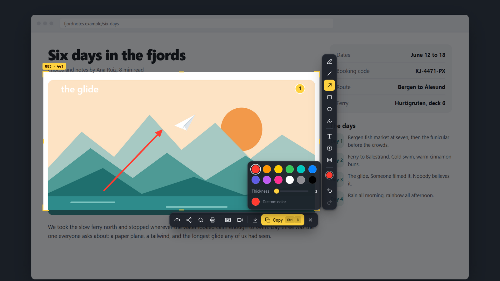
  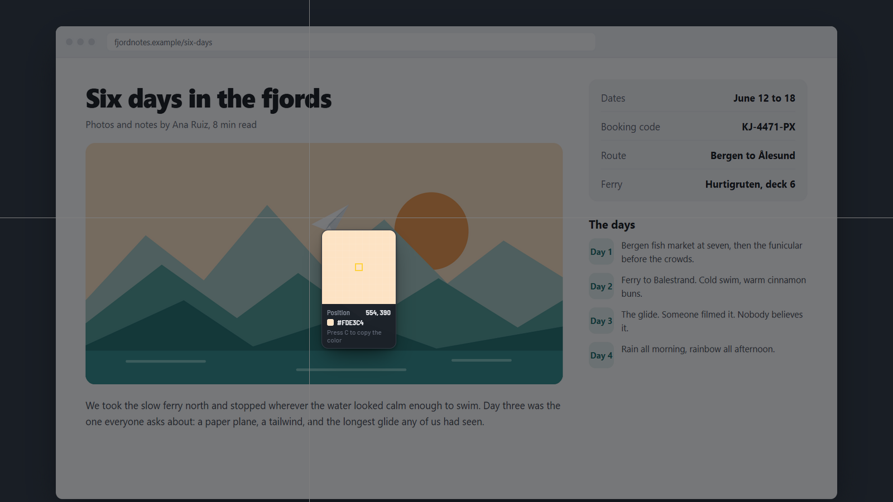
</p>

## GIFs and short videos

Pick an area and hit Record. The screen behind stays live, a red frame marks what is being recorded, and a small bar shows the time. Neither one shows up in the recording.

<p>
  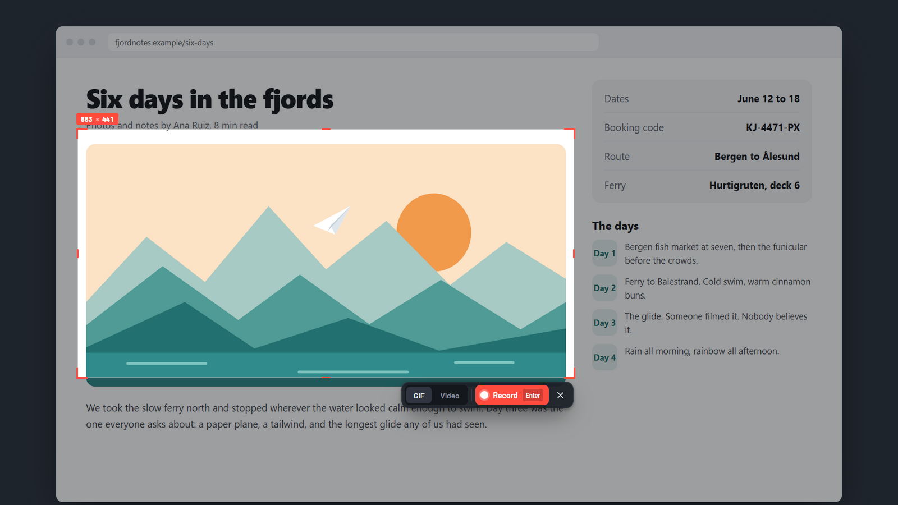
  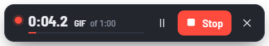
</p>

When you stop, the editor opens. Drag the yellow handles on the strip of real frames to trim, pick GIF, MP4 or WebM, set the frame rate and width, then copy, save, upload or share.

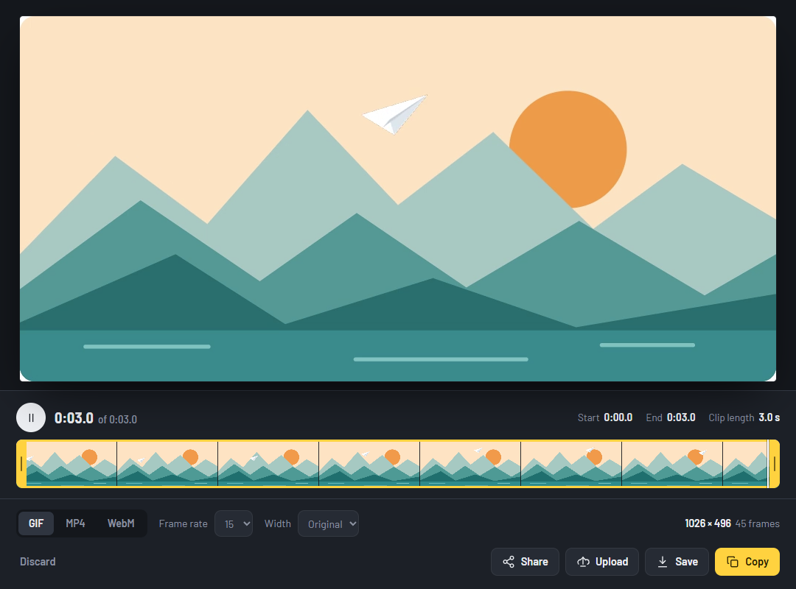

## Dashboard and captures

Double-click the tray icon for the dashboard. Every capture is also kept in Captures, grouped by day, with copy, upload, save and show-in-folder on hover.

<p>
  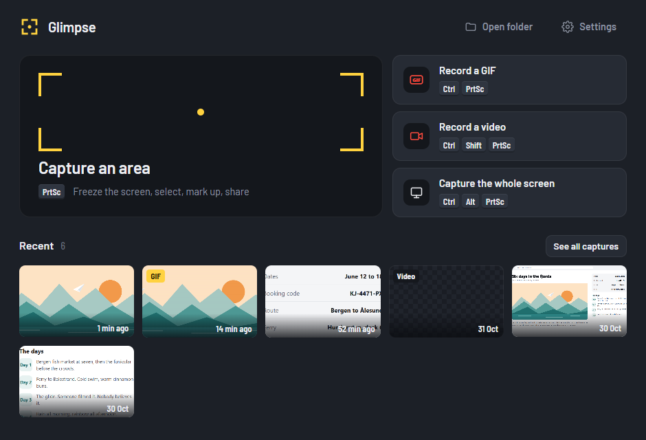
  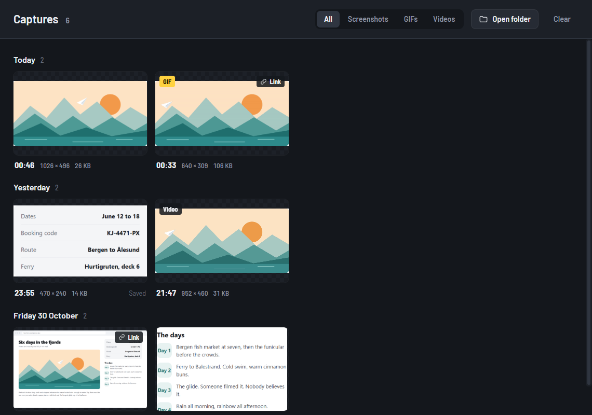
</p>

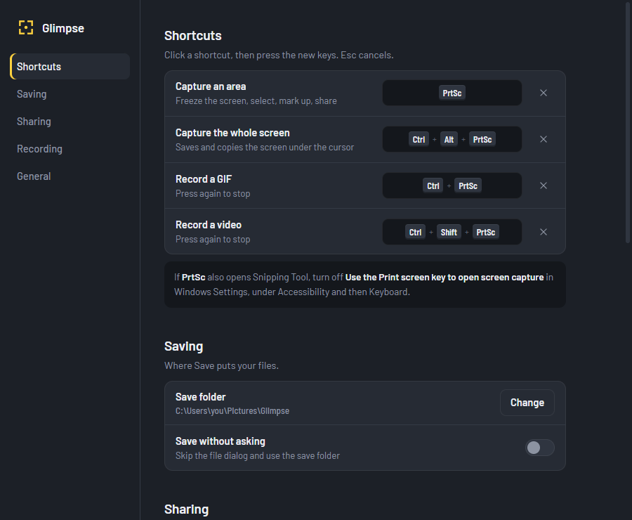

## Shortcuts

| Action | Default |
| --- | --- |
| Capture an area | <kbd>PrtSc</kbd> |
| Capture the whole screen (saves and copies) | <kbd>Ctrl</kbd> <kbd>Alt</kbd> <kbd>PrtSc</kbd> |
| Record a GIF (press again to stop) | <kbd>Ctrl</kbd> <kbd>PrtSc</kbd> |
| Record a video (press again to stop) | <kbd>Ctrl</kbd> <kbd>Shift</kbd> <kbd>PrtSc</kbd> |

Inside the capture overlay:

| Key | Does |
| --- | --- |
| <kbd>Ctrl</kbd> <kbd>C</kbd> or <kbd>Enter</kbd> | Copy |
| <kbd>Ctrl</kbd> <kbd>S</kbd> | Save |
| <kbd>Ctrl</kbd> <kbd>D</kbd> | Upload and copy link |
| <kbd>Ctrl</kbd> <kbd>F</kbd> | Find similar images |
| <kbd>Ctrl</kbd> <kbd>P</kbd> | Print |
| <kbd>Ctrl</kbd> <kbd>G</kbd> / <kbd>Ctrl</kbd> <kbd>R</kbd> | Record this area as a GIF / video |
| <kbd>Ctrl</kbd> <kbd>Z</kbd> / <kbd>Ctrl</kbd> <kbd>Y</kbd> | Undo / redo |
| <kbd>Ctrl</kbd> <kbd>A</kbd> | Select the whole screen |
| Arrows / <kbd>Shift</kbd> arrows | Move / resize the selection |
| <kbd>P</kbd> <kbd>L</kbd> <kbd>A</kbd> <kbd>R</kbd> <kbd>E</kbd> <kbd>M</kbd> <kbd>T</kbd> <kbd>N</kbd> <kbd>B</kbd> | Pencil, line, arrow, rectangle, ellipse, marker, text, step, pixelate |
| Right-click / <kbd>Esc</kbd> | Drop the tool / close |

All global shortcuts can be changed in Settings.

## Install

Glimpse runs on Windows 10 and 11. You need [Node.js](https://nodejs.org) 18 or newer.

```bash
git clone https://github.com/04r/glimpse.git
cd glimpse
npm install
npm start
```

`Glimpse.cmd` starts it without a console window, and Settings has a "Start with Windows" switch.

> If <kbd>PrtSc</kbd> opens the Windows Snipping Tool too, turn off **Settings → Accessibility → Keyboard → Use the Print screen key to open screen capture**.

## How it works

- **Electron** for the app.
- The overlay windows are created once and stay loaded off-screen, so a capture never waits for a window to open.
- Each overlay is excluded from screen capture, so it can dim the screen instantly while [`node-screenshots`](https://github.com/nashaofu/node-screenshots) grabs the pixels underneath.
- [`koffi`](https://koffi.dev) turns off the Windows window animations and hands keyboard focus back to the app you were in.
- Recording uses Chromium's screen capture and `MediaRecorder`. [`ffmpeg-static`](https://github.com/eugeneware/ffmpeg-static) trims and encodes GIF (two-pass palette), MP4 (H.264) and WebM (VP9).
- Uploads go to [catbox.moe](https://catbox.moe) (permanent) or litterbox (deleted after 1 hour to 3 days), anonymously. Nothing is uploaded unless you press Upload, Share or Find similar.

### Development

| Command | What it does |
| --- | --- |
| `npm run selftest` | Drives the real windows end to end: capture, mark-up, copy, GIF and MP4 export, and checks that the screen behind the record overlay stays live |
| `npm run speedtest` | Measures hotkey-to-frozen-screen time |
| `npm run docs` | Regenerates every image in `docs/` from a neutral sample page |

## License

MIT. The Barlow typeface is under the SIL Open Font License (`src/ui/fonts/OFL.txt`). The interface icons are adapted from [Lucide](https://lucide.dev) (ISC).
